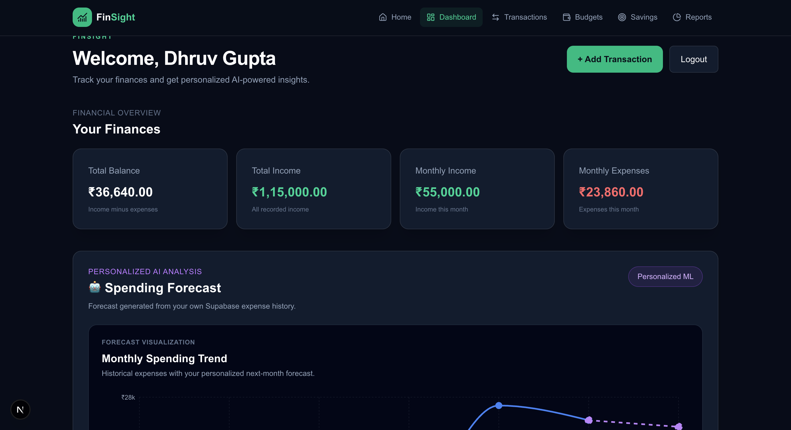
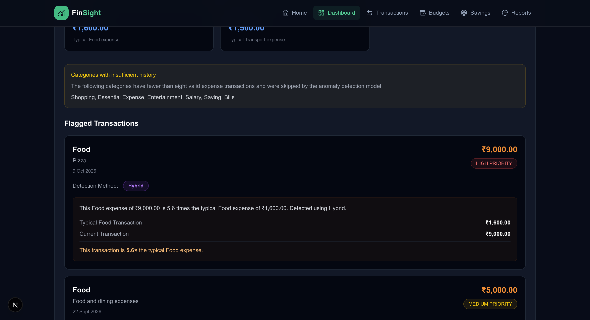
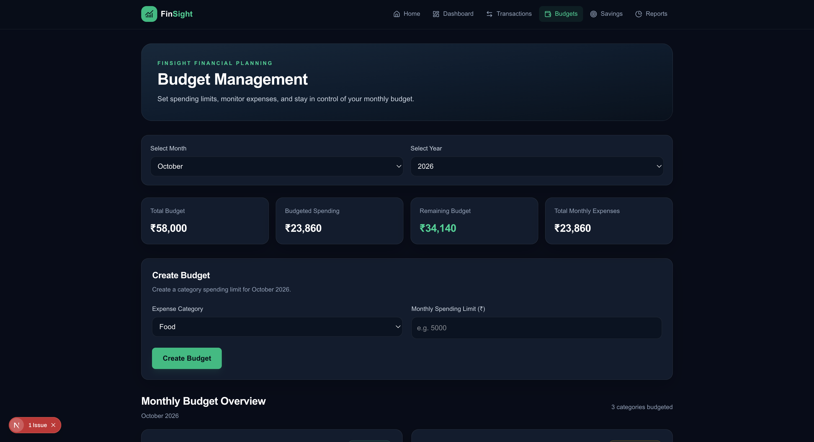
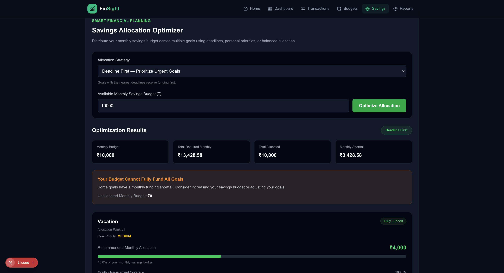
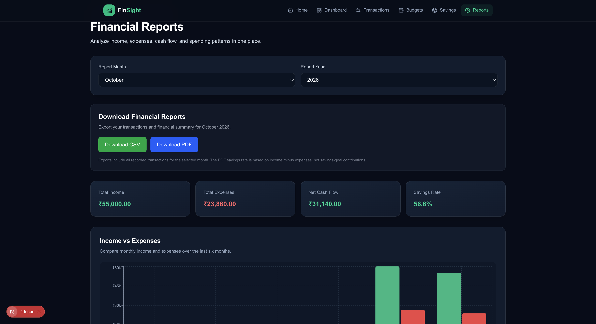

# FinSight — AI-Powered Personal Finance Management

**Track smarter. Budget better. Save with confidence.**

FinSight is a full-stack personal finance application that brings expense tracking, machine-learning insights, budgeting, savings planning, and financial reporting into one responsive dashboard.

> **Project status:** Local development and integration testing. Public deployment link coming soon.

## Product Preview

<!-- Capture screenshots from your running app using demo data, and save them to public/screenshots/ -->



*The financial overview brings together transaction insights, spending trends, forecasts, and anomaly alerts.*

## What Makes FinSight Different?

| Capability | What it does |
| --- | --- |
| **ML Expense Categorization** | Uses TF-IDF and Logistic Regression to suggest transaction categories. |
| **Spending Forecasting** | Estimates future spending from transaction history. |
| **Anomaly Detection** | Highlights unusual transactions and spending behavior. |
| **Intelligent Budgeting** | Tracks category budgets and provides budget recommendations and trend analytics. |
| **Savings Optimization** | Manages savings goals with allocation recommendations, forecasting, risk analysis, and scenario simulation. |
| **Financial Reporting** | Visualizes income, expenses, and cash flow; exports reports as CSV or PDF. |
| **Secure User Accounts** | Uses Supabase authentication and row-level security for user-specific financial data. |

## Screenshots — Feature Highlights

### 1. AI Financial Dashboard


### 2. ML-Assisted Transaction Classification


### 3. Budget Analytics and Recommendations


### 4. Savings Goals and Allocation Optimizer


### 5. Financial Reports and Exports


> Screenshots are placeholders until actual app screenshots are added at these paths. Use a demo account with fictitious financial data; hide email addresses, tokens, and personal information.

## Tech Stack

| Layer | Technologies |
| --- | --- |
| Frontend | Next.js (App Router), React, TypeScript, Tailwind CSS |
| Backend | Python, FastAPI |
| Machine Learning | scikit-learn, TF-IDF, Logistic Regression |
| Authentication & Database | Supabase Auth, PostgreSQL, Row Level Security |
| Visualization | Recharts |
| Reports | CSV export, jsPDF / AutoTable |

## Application Modules

- **Dashboard:** financial summary, visualizations, forecasts, AI budget suggestions, and anomaly alerts.
- **Transactions:** add, edit, delete, filter, and classify transactions.
- **Budget:** category-level budgets, spending thresholds, analytics, and trends.
- **Savings:** savings goals, contributions, recommendations, forecasting, risk analysis, simulation, and allocation optimization.
- **Reports:** monthly and six-month financial analysis, charts, and exports.
- **Authentication:** signup, login, logout, session persistence, and protected financial pages.

## Getting Started

### Prerequisites

- Node.js and npm
- Python 3 and pip
- A Supabase project with the application tables and RLS policies configured

### 1. Clone the repository

```bash
git clone https://github.com/YOUR_USERNAME/FinSight.git
cd FinSight
```

### 2. Install frontend dependencies

```bash
npm install
```

### 3. Configure environment variables

Create `.env.local` in the Next.js project root using your project's existing Supabase environment variable names. For example, if your Supabase client reads the following names:

```dotenv
NEXT_PUBLIC_SUPABASE_URL=your_supabase_project_url
NEXT_PUBLIC_SUPABASE_ANON_KEY=your_supabase_publishable_or_anon_key
```

**Check `supabase.ts` for the exact names your application expects.** Never put a Supabase service-role/secret key in a `NEXT_PUBLIC_` variable or commit any real credentials.

### 4. Run the frontend

```bash
npm run dev
```

Open http://localhost:3000.

### 5. Run the FastAPI backend

From the backend directory (adjust the path to match your repository):

```bash
python3 -m venv .venv
source .venv/bin/activate
pip install -r requirements.txt
uvicorn main:app --reload --port 8000
```

Open http://127.0.0.1:8000/docs to inspect the API. Update the commands if your FastAPI entry point or dependency file differs. Make sure the frontend's configured backend URL points to your running API.

## ML Workflow

```text
Transaction description
        ↓
Text preprocessing + TF-IDF vectorization
        ↓
Logistic Regression classifier
        ↓
Suggested expense category
        ↓
User confirmation / saved transaction
```

FinSight also exposes backend functionality for spending forecasts, anomaly detection, and financial recommendations. The prediction results depend on the data and models configured in your backend.

## Security and Privacy

- Supabase Auth for account access
- Row Level Security for per-user database isolation
- Environment variables for configuration
- Do not commit `.env*` secrets, credentials, personal financial data, or trained models containing sensitive information

## Testing

The application has been manually tested locally for frontend/backend connectivity, authentication, protected routes, user data isolation, transaction CRUD, and ML-assisted transaction workflows. Automated test coverage and public deployment are future improvements.

## Roadmap

- [ ] Add automated frontend and backend tests
- [ ] Deploy frontend and backend
- [ ] Add monitoring and production error tracking
- [ ] Evaluate and document ML model performance on held-out test data
- [ ] Improve accessibility and mobile testing

## Author

Built as a full-stack AI/ML personal finance project.

<!-- Replace with your actual GitHub and LinkedIn profile links before publishing. -->
